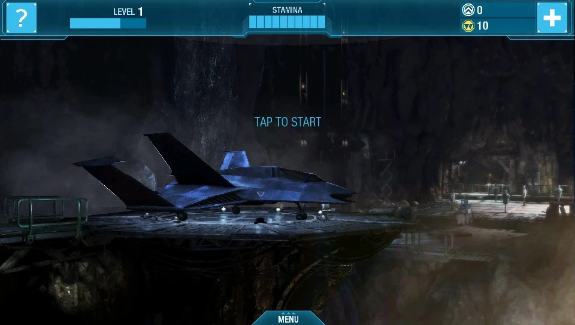
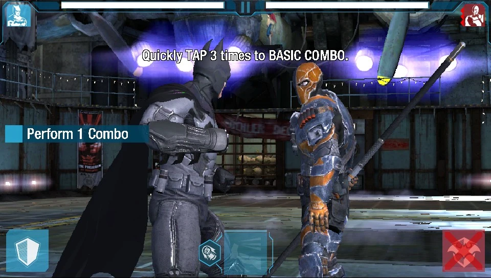
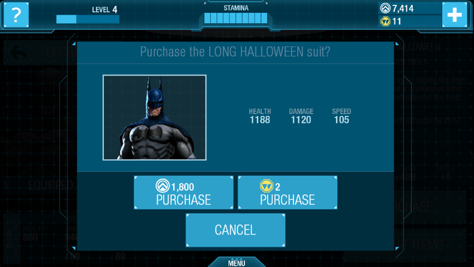

<p align="center">
  
</p>

---

A port of the Android version of Batman: Arkham Origins (the mobile fighting game) to the PS Vita.
It runs the game's original code natively, nothing is emulated.

> [!IMPORTANT]
> **No game files are included here or in the release.** You need your own copy of the Android
> game, version 1.3.0.

<p align="center">
  
  
</p>

## Download & Install

Grab `batmanarkhamorigins.vpk` from the [Releases](../../releases) page and install it with
VitaShell. You need a Vita with HENkaku/Ensō, plus two things most people already have:

* [kubridge](https://github.com/bythos14/kubridge/releases): put `kubridge.skprx` in `ur0:tai/`,
  add it under `*KERNEL` in `ur0:tai/config.txt` and reboot.
* `libshacccg.suprx`, installed with [ShaRKBR33D](https://github.com/Rinnegatamante/ShaRKBR33D/releases).
  The game's shaders get compiled on the Vita with it.

Then the game files. You need two files from your Android copy (version 1.3.0, version code 3030):
`libUnrealEngine3.so` from the APK (it's in `lib/armeabi-v7a/`) and the expansion file from
`Android/obb/com.wb.goog.batman.brawler2013/`. Make a folder called `batmanarkhamorigins` in
`ux0:data/` and copy them in, like this:

```
ux0:data/
└── batmanarkhamorigins/
    ├── libUnrealEngine3.so
    └── main.3030.com.wb.goog.batman.brawler2013.obb
```

Keep the names exactly as they are. The OBB is only read, never modified.

The first boot takes a few minutes on a black screen. That's the Vita compiling the game's ~390
shaders, and it only happens once (they're cached in `shader_cache/`). After that it reaches the
menu in about a minute. The intro movie at boot can be skipped with any button.

Saves, settings and the log (`log.txt`) all go to `ux0:data/batmanarkhamorigins/`.

## Controls

The game is touch only, so every button is turned into a touch. The touchscreen works as it is,
use whichever you like.

| Vita | Does |
|---|---|
| Square / Cross | Attack (tap three times quickly for the basic combo) |
| Triangle (hold) | Block |
| Circle | Switch stance |
| R | Special attack |
| L | The small icon next to the special |
| D-Pad / Right stick | Swipes, for the drag prompts that finish combos |
| Start | Pause |

The mapping lives in `ux0:data/batmanarkhamorigins/controls.txt`, written the first time you play.
Each line is a button and a spot on the screen (960x544), so you can move things around:

```
SQUARE tap 620 300
TRIANGLE hold 55 490
UP swipe 480 380 0 -220
```

Delete the file to get the defaults back.

## What's different from the phone version

* **No stamina waits.** Starting a mission still spends stamina like before, but it fills back up
  a few seconds later, so you never have to wait to keep playing.
* **The store is cheaper.** Next to the other files there's a `store.txt` with three settings:
  `suit_discount` (percent off every batsuit, 90 by default), `premium_per_win` (premium currency
  you get for every mission won, 5 by default) and `unlock_all_suits` (1 gives you every suit).
  The two console-exclusive suits can be bought too.
* **The online stuff is gone.** WB ID, Facebook, cloud saves and real-money purchases don't exist
  on the Vita, so they stay off.

<p align="center">
  
</p>

## AI Assistance

Parts of the code were written or improved with the assistance of AI (Claude, by Anthropic). That
includes a good part of the port itself: the Android shims, the threading and file handling fixes,
the movie player, the controls and the store and stamina changes. All AI-assisted code was
reviewed, tested, and manually validated, with the overall implementation and debugging process
remaining under human supervision.

## Credits

* **NetherRealm Studios and WB Games** for Batman: Arkham Origins. This project isn't affiliated
  with them.
* **so_util** and the **so-loader boilerplate** by Andy Nguyen, Rinnegatamante and Volodymyr
  Atamanenko.
* **FalsoJNI** by Volodymyr Atamanenko.
* **vitaGL** and **vitaShaRK** by Rinnegatamante.
* **kubridge** by bythos.
* **minimp3** by lieff, plays the music.
* **VitaSDK** and the Vita homebrew scene.

## Building from source

The Android library uses the softfp ABI, so you need [VitaSDK softfp](https://github.com/vitasdk-softfp)
with these packages from its vdpm: `zlib kubridge vitaShaRK libmathneon vitaGL SceShaccCgExt taihen`.

The LiveArea pictures aren't in the repo because they come from the game's art, so make them once
from your own APK (or drop your own `icon0.png`, `pic0.png`, `bg0.png` and `startup.png` in a folder), copy
`livearea/template.xml` next to them, then build:

```bash
python3 scripts/make_livearea.py your_game.apk my_livearea
cp livearea/template.xml my_livearea/
cmake -S . -B build -DLIVEAREA_DIR=$PWD/my_livearea
cmake --build build
```

The VPK ends up in `build/batmanarkhamorigins.vpk`. vitaGL and vitaShaRK are built from the
submodules. A few options that help when something breaks:

* `-DDEBUG_SHOTS=ON` logs the frame rate, memory and threads every 5 seconds, SELECT saves a
  screenshot, and a watchdog crashes the game on purpose if it stops for a minute (so you get a
  coredump that shows where it got stuck).
* `-DGL_TRACE=ON` (with the one above) also dumps every GL call of the next frame on SELECT.
* `-DVERBOSE_LOG=ON` logs every file access and JNI call.

### How it works, roughly

* `main.c` replays what the Java side of the Android app does at startup, in the same order, then
  feeds touch and buttons in.
* `jni_impl.c` answers the engine's calls into Java. EGL is vitaGL, the expansion file is read
  straight from `ux0:data`.
* `opensl.c` is a small OpenSL ES for the sound effects, `audio.c` plays the music (MP3s inside the
  OBB) and `movie.c` plays the intro movies with sceAvPlayer.
* `atc.c` turns the game's ATC textures into DXT on upload so they stay compressed on the GPU.
* `pthread_bionic.c` has its own mutexes and condition variables. The menus keep thousands of them
  alive, way more kernel objects than the Vita gives one app.
* `bionic.c` gives every open of the OBB a virtual file handle, because the engine keeps one open
  per loaded package and the Vita runs out of real ones a few levels in.
* `store.c` and `patch.c` hold the stamina and store changes.

## Known issues

- Updating from an older build: delete `ux0:data/batmanarkhamorigins/shader_cache` if the first boot crashes. The shaders are rebuilt on the next boot.
